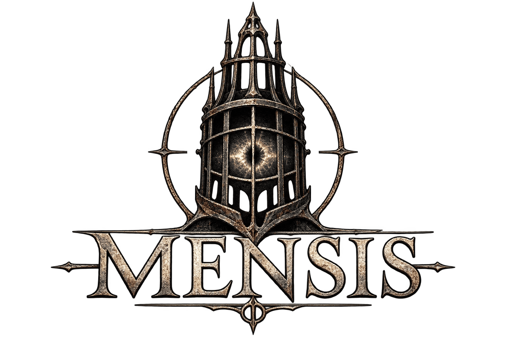
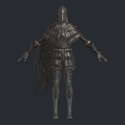
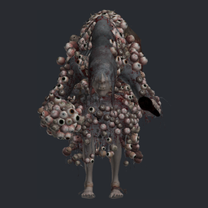

<h1 align="center">
  
</h1>

Taking apart the PS4 *Bloodborne: Game of the Year Edition* (CUSA03173, EU) to see how it is built,
in the same spirit as *Confederation*, a sibling project, does for *Wing Commander*.

**The name.** In the game, the School of Mensis is a scholarly order. With the Choir it forms "the
upper echelons of the Healing Church", and it founded the Unseen Village, Yahar'gul. Its scholars
wear the Mensis Cage, an iron cage around the head that, in the game's own words, "restrains the
will of the self, allowing one to see the profane world for what it is". Seeing past the surface
of the thing to how it works is what this project is about.

## What's here

**The package opens all the way down.** It is a *fake* (homebrew re-signed) PKG, so its keys are
public: `tools/pkgtool.py` decrypts it and produces the game's real filesystem, 28,808 files and
29.3 GiB.

**The executable decompiles.** It is a *fake* SELF with plaintext segments. Converted back to an
ordinary x86-64 ELF and prepared for Ghidra, it analyzes in about 24 minutes: 167,054 functions,
all 701 system imports named, and about 900 functions and 110 globals named from the strings
the engine leaves behind or by hand, each with its evidence.

**The data reads, in the game's own terms.** The game ships the layouts of its tables, the names
of its event instructions and the names of its events, all in Japanese, and the tools here use
them: gameplay tables field by field, event scripts instruction by instruction, AI and talk
scripts, and map layouts.

**The artwork comes out.** Textures are block-compressed and stored in the PS4 GPU's tiled
layout. Untiled and decoded, they come out as ordinary PNG files: 1,056 item pictures, and every
character, equipment, object and map texture. The 3D models read too, so the tools export them
to OBJ and render every character and piece of equipment as a picture.

A sample of what the tools produce: item pictures as the game ships them (`textures.py items`),
and character models rendered from the game's own meshes and textures (`flver.py`):

<table>
<tr>
<td align="center" width="25%"><br><sub>Mensis Cage</sub></td>
<td align="center" width="25%"><br><sub>Saw Cleaver</sub></td>
<td align="center" width="25%"><br><sub>Blood Vial</sub></td>
<td align="center" width="25%"><br><sub>Cainhurst Badge</sub></td>
</tr>
<tr>
<td align="center" width="25%"><br><sub>A hunter in the Cainhurst Armor</sub></td>
<td align="center" width="25%"><br><sub>c1110, Patches the spider</sub></td>
<td align="center" width="25%"><br><sub>c5100, Rom, the Vacuous Spider</sub></td>
<td align="center" width="25%"><br><sub>c2100, the Witch of Hemwick</sub></td>
</tr>
</table>

**Together they answer real questions.** Five worked examples so far:

* [What the 1.09 patch changed](docs/the-patch.md): developer tooling switched off, the balance
  changes, elevator, DLC and NPC fixes, and changes that span code, data, scripts and layout.
* [Where the items are](docs/the-items.md): every treasure, drop, event award and shop row, down
  to which badge unlocks the Chikage.
* [The Chalice Dungeons](docs/the-chalice-dungeons.md): "random" Root Chalice dungeons are one of
  100 or 200 layouts that ship with the game, and [their event scripts](docs/the-chalice-events.md)
  show what the rites do inside them: every variant is already placed, and the script removes
  all but one. A ritual's roll is steered toward unique items you haven't picked up yet.
* [Event flags](docs/the-flags.md): every place the game's world state is read or set, across
  event scripts, talk scripts and tables, and the 24 flag ranges that hold the NPCs' stories.
  [The questlines](docs/the-questlines.md) read each range into a sheet of states,
  conversations and gifts, and one character's story from hers.
* [The online boundary](docs/the-online-boundary.md): where the game stops working for itself and
  asks a server, how it finds that server, the 37 requests it can send, and what that means for
  running it off a PS4.

## Reading order

1. [The package](docs/the-package.md): PKG → encrypted PFS → PFSC → inner PFS, the key chain,
   PlayGo, and what the 1.09 update replaces.
2. [The executable](docs/the-executable.md): SELF → ELF, imports, and the engine and middleware it
   was built from.
3. [Loading it into Ghidra](docs/ghidra.md): from `eboot.bin` to an analyzed, partly named Ghidra
   project, why each step is needed, how two builds are compared, and how functions get names.
4. [The data](docs/the-data.md): the `dvdroot_ps4` tree, every file format in it, map IDs, params
   and text, and the readers for them.
5. [Where the items are](docs/the-items.md): the readers joined into one answer.
6. [The Chalice Dungeons](docs/the-chalice-dungeons.md): rituals, their 100 or 200 pre-built
   layouts, the rites, the deeper chalices the tables define but the game doesn't contain,
   glyphs, and how a ritual rolls and saves its layout.
7. [The Chalice Dungeons' event scripts](docs/the-chalice-events.md): one template library run
   by 2,641 layouts, the special enemies and characters, the bell-ringing women, and the bosses'
   working names.
8. [What the 1.09 patch changed](docs/the-patch.md): every kind of replaced file, read and
   explained.
9. [The online boundary](docs/the-online-boundary.md): which features need a server, which server
   each uses, and what an emulator or replacement server faces.
10. [Textures and item pictures](docs/the-textures.md): getting the game's 2D artwork out as PNG
    files, through the TPF container, the PS4's tiled layout and block compression.
11. [Models and character renders](docs/the-models.md): the FLVER model format, exporting models
    to OBJ, and a small software renderer that draws every character and piece of equipment.
12. [Event flags](docs/the-flags.md): an index of every read and write of the game's world state,
    through event templates and talk scripts, and the NPCs' state ranges.
13. [The questlines](docs/the-questlines.md): each NPC's states, every conversation with the path
    that leads to it, what they hand over, and the lonely old woman's story read from the data.

Each page says how its results were obtained, including the wrong turns that were corrected on
the way, so the method can be followed and checked. To reproduce everything from your own copy
of the game, [rebuilding `work/`](docs/rebuilding-work.md) goes through every step in order.

## Setup

The tools are Python scripts; their dependencies (`cryptography`, `pyelftools`, `capstone`,
`pillow`, `numpy`) are in `pyproject.toml`:

```
uv venv .venv && uv pip install --python .venv -r pyproject.toml
```

or the equivalent with `python -m venv .venv` and `pip install cryptography pyelftools capstone pillow numpy`.
`python` below means the one in `.venv` (`.venv/Scripts/python` on Windows).

For the Ghidra work you also need Ghidra 12.2 and a JDK 25, located through two environment
variables (see [Loading it into Ghidra](docs/ghidra.md#what-you-need)):

| Variable | Points at |
|---|---|
| `GHIDRA_INSTALL_DIR` | the Ghidra install folder |
| `JAVA_HOME` | the JDK |
| `MENSIS_PYTHON` | *(optional)* a Python other than `.venv`'s |
| `GHIDRA_HEADLESS_MAXMEM` | *(optional)* heap for headless analysis, default 20G |

## Tools

**The package**

```
python -I tools/pkgtool.py info|list|extract <pkg> …        # PKG/PFS: keys, file tree, extraction
python -I tools/unfself.py <eboot.bin> <out.elf>              # fake SELF → ELF
```

`tools/pkgkeys.py` holds the public fake-package RSA keys.

**The executable** (see [Loading it into Ghidra](docs/ghidra.md))

```
python -I tools/orbis_prep.py <elf> <nid-db> <out.elf> <out.tsv>        # ELF → Ghidra-ready + symbols
pwsh tools/ghidra/analyze.ps1 -Self <eboot.bin> -Name <name>            # the whole Ghidra pipeline
python -I tools/build_diff.py <old.tsv> <new.tsv> <out.md> [--pairs …]  # compare two builds
python -I tools/port_names.py <names.tsv> <from.tsv> <to.tsv> <out>     # carry names across builds
python -I tools/c_diff.py <pairs> <old.tsv> <new.tsv> <old-c> <new-c> <out.md>   # diff decompiled C
```

`tools/ghidra/` holds the Ghidra scripts: `ApplyOrbisSymbols.java` (names and function starts
before analysis), `OrbisReport.java` (summary and landmark decompilations),
`ExportFunctionHashes.java` (per-function hashes for `build_diff.py`), `NameFromStrings.java`
(names from step tables, profiler markers and singleton asserts), `ApplyNames.java` (apply a
hand-written name list), and, for exploring, `FindStringUses.java`, `RefsTo.java`,
`MostCalled.java`, `Decompile.java` and `DeleteProjectFile.java`. `tools/names/` holds the hand-assigned names for
each build, one per line with a confidence level and the evidence for it.

**The data** (see [The data](docs/the-data.md))

```
python -I tools/souls.py dcx|bnd|fmg|param <file> …                 # DCX, BND4, FMG text
python -I tools/params.py check|dump|diff <parambnd> <paramdefbnd> … # gameplay tables
python -I tools/events.py check|dump|diff <emedf> <emevd> …          # event scripts
python -I tools/lua50.py dis|diff <luabnd> …                         # AI scripts (Lua 5.0)
python -I tools/esd.py check|dump|diff <talkesdbnd> …                # talk scripts (ESD)
python -I tools/msb.py check|dump|diff <msb> …                       # map layouts (MSB)
```

**Joining it up**

```
python -I tools/items.py world|find <base dvdroot> <update dvdroot> …   # where every item is
python -I tools/chalice.py <base dvdroot> <update dvdroot> <out.md>      # the Chalice Dungeon catalog
python -I tools/chalice_events.py <base dvdroot> <update dvdroot> <out.md>   # their event scripts
python -I tools/flags.py index|show <base dvdroot> <update dvdroot> …         # where every event flag is read and set
python -I tools/story.py ranges|sheet|sheets <base dvdroot> <update dvdroot> …  # the NPCs' questlines
```

**Checking**

```
python -I tools/check.py run|record|list     # rerun the tools, compare outputs with tools/check-hashes.tsv
```

**The artwork** (see [Textures and item pictures](docs/the-textures.md) and
[Models and character renders](docs/the-models.md))

```
python -I tools/textures.py tpf <file> <out dir>                               # a TPF, or the TPFs in an archive -> PNG
python -I tools/textures.py items <base dvdroot> <update dvdroot> <out dir>    # item pictures, named
python -I tools/textures.py models <base> <update> <out dir> [chr,parts,obj,map] # model and map textures
python -I tools/flver.py info|obj|render <archive> …                          # a model: summary, OBJ export, picture
python -I tools/flver.py all <base dvdroot> <update dvdroot> <out dir>         # every character rendered
python -I tools/flver.py parts <base dvdroot> <update dvdroot> <out dir>       # every piece of equipment rendered
python -I tools/flver.py hunter|hunters <base> <update> <out> …                # whole hunters in armor sets
```

## Working files (`work/`, ~40 GiB, not source)

Everything the tools produce goes under `work/`, which `.gitignore` excludes: it is the game's
own data, or derived from it. [Rebuilding `work/`](docs/rebuilding-work.md) recreates it from
scratch. The only generated pictures in the repository are the eight samples above, in
`assets/showcase/`, reduced to 256×256.

| Path | |
|---|---|
| `work/base/`, `work/update/` | the extracted 1.00 game and 1.09 patch; lay `update/` over `base/` for the current game |
| `work/base-files.txt`, `work/update-files.txt` | full file listings with sizes |
| `work/elf/` | both executables and the bundled `.prx` modules as ELFs (plus import lists written while exploring; `work/ghidra/*.symbols.tsv` holds the same imports) |
| `work/ref/aerolib.inl` | NID → name database (shadPS4), downloaded on first use |
| `work/ghidra/` | Ghidra-ready ELFs and symbols, the project with both builds (`project/Bloodborne.gpr`), reports, naming logs, and `diff/` (function hashes, the build diff, decompiled pairs) |
| `work/params/`, `work/events/`, `work/ai/`, `work/talk/`, `work/msb/` | the 1.00 → 1.09 diffs of each kind of data |
| `work/items/`, `work/chalice/` | the generated item index, the Chalice catalog and the Chalice event-script summary |
| `work/story/` | the event-flag index, and `npcs/`: a questline sheet per NPC |
| `work/pictures/` | artwork extracted as PNG: `items/` (the item pictures), `models/` (character and equipment textures; object and map textures if asked for), `renders/` (every character drawn), `equipment/` (every weapon and armor piece drawn), `hunters/` (every armor set worn) and `obj/` (exported models), each with an index |
| `work/check/` | the regression check's outputs, recreated on each run |
| `work/ghidra/explore/`, `work/flags/` | scratch output from exploring (string searches, decompiled functions, script dumps); not needed to rebuild anything |

## License

**Mensis**, Notes and Tools for Taking Apart *Bloodborne*\
Copyright (C) 2026 [Jeff Nyman][owner]

[][GNU General Public License]

> This program is free software: you can redistribute it and/or modify
> it under the terms of the [GNU General Public License] as published by
> the Free Software Foundation, either version 3 of the License, or
> (at your option) any later version.
>
> This program is distributed in the hope that it will be useful,
> but WITHOUT ANY WARRANTY; without even the implied warranty of
> MERCHANTABILITY or FITNESS FOR A PARTICULAR PURPOSE. See the
> [GNU General Public License] for more details.

[owner]: https://github.com/jeffnyman
[GNU General Public License]: https://www.gnu.org/licenses/gpl-3.0.en.html

The PKG decryption in `tools/pkgtool.py` and the keys in `tools/pkgkeys.py` are ported from
[shadPS4](https://github.com/shadps4-emu/shadPS4) v0.7.0, licensed GPL-2.0-or-later, which is
used here under version 3. The NID name database the Ghidra pipeline downloads also comes from
shadPS4 and is not part of this repository.

`tools/esd.py` and `tools/msb.py` follow the ESD and MSB layouts documented by
[SoulsFormats](https://github.com/JKAnderson/SoulsFormats), and `esd.py` the expression bytecode
documented by [ESDLang](https://github.com/thefifthmatt/ESDLang), both MIT-licensed.
